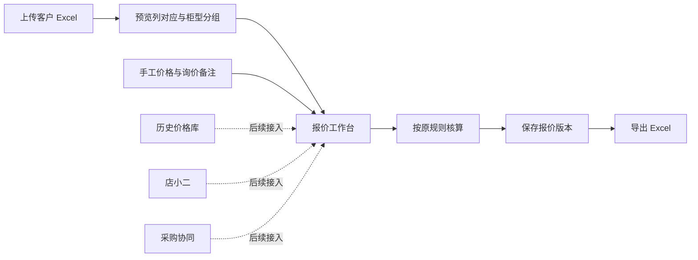

**京能成套报价工作台方案 v1**

日期：2026-10-21（北京时间）。状态：方案，尚未实现或接入外部价格服务。

本文保留立项时的方案快照。当前已实现范围以 [使用说明](./quote-workbench-usage.md) 和 [验收记录](./quote-workbench-verification.md) 为准。

用户目标：客户 Excel 一次导入，能增加、删除、修改物料，沿用现有报价算法。历史价格库、店小二和采购协同延后，第一期先完成可以实际使用的报价闭环。

**1. 建议的产品形态与现有基础**

建议在现有报价管理中增加“报价工作台”，沿用客户、项目、报价单号和版本关系。主要操作放在一张可批量编辑的表格中。每个报价下面有若干柜型，每个柜型分别包含单台物料、费用、工时和柜型数量。

已核实的本地代码情况：

- `frontend/` 已有 React + TypeScript 工程、报价列表、新建、详情及 API 封装。根 README 中“React 待启动”的描述已落后于代码。
- `frontend/src/pages/Quotes/QuoteForm.tsx:36` 当前算法是明细合计后统一加税，不符合本次 Excel 的计费基数。
- `frontend/src/api/client.ts:10` 源码默认启用 Mock。本次没有运行应用，不能将源代码或演示页面视为真实保存、审批与导出已经可用。
- `db/schema.sql:252` 的报价表和 `:286` 的明细表可以作为扩展起点。但当前的未税小计、统一税率和两位小数单价设计，不能直接承载本次原算法。
- `docs/backend-quote-approval-plan.md` 是既有后端方案，其中“单价默认未税、明细统一加税、先手工明细”的假设不适用于本次成套报价工作台。具体计算以本方案的 Excel 对照规则为准；报价身份、权限、审批记录等公共能力仍可复用，尚未实现的能力需要实际建设。

业务计算不依赖 Excel 行号。导出时根据实际物料条数生成行和公式，避免增删物料后漏入求和区间。

**2. 第一期的操作流程**



首次遇到某种客户格式时，用户确认一次表头、列对应和数量口径；同样格式再次上传时自动套用映射，仅核对变化与异常。映射按文件结构保存，不能只凭客户名称套用。不同客户、同一客户的新格式都能重新映射。

导入默认新建报价。向已有报价导入时明确选择“追加到指定柜型”或“替换指定柜型物料”，先显示影响范围并保留上一版本。导入失败不留下半张单，不清空旧表，也不修改原始文件。

**3. 导入必须解决的实际问题**

| 情况 | 第一期行为 |
| --- | --- |
| 多工作表或一页多柜型 | 可选择多个工作表，标记每段所属柜型；识别结果允许修正 |
| 标题行、说明行、重复表头、小计、总计 | 标记为非物料行；预览中可查看，避免二次汇总 |
| 合并单元格 | 根据分组含义展开柜名等字段，禁止盲目向下填充数量和价格 |
| 隐藏行、隐藏工作表 | 明确显示并选择是否纳入，不静默丢弃或计入 |
| 数量属于单台还是整单 | 每个导入分组确认；数量口径不明时标记待确认，不默认再乘柜数 |
| 只有整单物料汇总 | 支持保存为未分配清单；在完成柜型分配前，不伪造单柜成本 |
| 原型号、品牌、备注 | 原文保留；用于匹配的清洗值另存，不能改丢型号后缀、连字符和前导零 |
| 公式单元格 | 记录公式与文件保存值；缺少可靠数值时提示核对，不将客户公式当作本系统计价规则 |
| 同型号多行 | 保留每行位置和归属；仅提示重复，不自动删除或合并数量 |
| 已有客户价格 | 作为导入价格及来源保存，不默认认定是采购成本或覆盖内部采用价 |

首期明确支持 `.xlsx` 和从 Excel 复制粘贴的二维数据。`.xls` 可作为兼容项单独验证后启用；图片清单、PDF 识别、扫描 OCR、任意复杂工作簿的全自动理解后置。不能承诺所有客户 Excel 都能零确认导入。

每条记录保留源文件、工作表、原始行号和导入批次。由系统生成稳定的记录 ID，排序、删除或插入不会把价格和备注串到其他物料。

**4. 工作台页面和第一期功能**

| 区域 | 内容与操作 |
| --- | --- |
| 顶部 | 客户、项目、报价编号、版本、保存状态、导入、保存版本、导出 |
| 左侧 | 柜型列表、柜型数量、柜型金额、待处理条数；新建、复制、删除柜型 |
| 中间 | 物料表格：名称、型号、品牌、单台数量、单位、采用单价、合价、价格状态、交期、备注 |
| 右侧抽屉 | 选中物料的原始数据、来源、内部备注、对客备注、询价说明 |
| 下方 | 柜体、辅材、标牌、运费、包装、成套/检验/调试工时及单价、费率、单台与整单结果 |

交互重点：直接编辑单元格、Tab/Enter 连续输入、复制粘贴多行、批量修改、批量删除、复制物料、复制柜型、撤销本次批量操作、筛选缺价项和交期待确认项、冻结关键列。

批量操作先说明适用范围，例如“当前柜型的选中 8 行”，不能把当前筛选结果与全部数据混为一谈。批量粘贴作为一次操作整体撤销。

计算列只读，但可以点击查看算式和构成。可编辑输入与计算结果有文字说明；状态同时使用文字和颜色。

第一期提供实际持久化保存，刷新和重启服务后可继续。自动保存显示“保存中/已保存/保存失败”，失败保留编辑内容。已有报价支持复制新单与保存新版本，不覆盖原来已报出的记录。多人同时编辑至少检测版本冲突，避免后保存者静默覆盖前一人的修改。

桌面端承担批量报价。手机端优先支持查看、备注和后续审批，完整的手机批量编辑不作为首期目标。

**5. 原算法的迁移规则**

基准文件：用户提供的本地原报价 Excel。公开文档省略客户名称、订单编号和原始文件名；原文件不进入仓库。

核对时文件 SHA-256：`5c462fded8575bf3e40a821aafa2493e790e3ac4b2a0fea3314930de103e6619`。这一份只用于建立明确的计算版本，并不自动证明其他历史模板都采用同一算法。

按单台柜型定义：

- M：元器件金额之和，逐行数量 × 采用单价。
- C：柜体金额。
- H：成套、检验、调试各自的工时 × 各自工时单价之和。
- R：辅材＋标牌＋运费＋包装＋H。
- m：管理费率，样本为 4%。
- t：原表“税费”加成率，样本为 3%。
- p：利润率，样本为空，旧公式按零计算。

```text
管理费 = (M + R) × m
原表“税费” = R × t
利润 = (M + R) × p
单台总价 = M + C + R + 管理费 + 原表“税费” + 利润
不含税展示价 = 单台总价 ÷ 1.13
最终优惠价 = 单台总价           （当前样本公式）
柜型合计 = 最终优惠价 × 柜型数量
整单总额 = 各柜型合计之和
```

兼容要求：

1. 柜体不进入管理费、原表“税费”和利润的计费基数；元器件不进入原表 3% 的计费基数。
2. 4% 与 3% 分别计算，不叠乘；不再对整单额外加一次 13%。
3. 工时仍由人填写，35 元是本样本默认输入；每种工时的单价单独保存，不擅自强制成一个不可修改的全局单价。
4. 工时备注 `8+30+11`、`1+1+2`、`1+4+2` 保留为说明，不擅自解释工序或将它们再累计一次。
5. 费率、柜数、工时和价格是输入；算法结构固定并标记版本。以后经业务确认修改规则时创建新版本，旧报价仍用旧规则。
6. 采用高精度十进制计算，保留中间单价与最终展示金额的区别。不能把 `3340.5132` 先存成 `3340.51` 再乘数量。数据库精度在实施时按输入范围确定，至少覆盖样本的小数位。
7. 原表空白在算术中的兼容行为和“是否已经确认价格”的状态分开处理。缺价不能在界面上显示成已完成的零价。草稿可显示按旧规则计算的暂算金额及待确认项目；正式完成状态需要解决缺价或明确客户供料、免费、不计价等原因。这是数据状态检查，不改费用公式。
8. 当前 3% 加成与除以 1.13 的业务含义尚未明确，迁移时照原表实现，不替用户重定义税务口径。

基准结果：

| 柜型 | 数量 | 单台成套/检验/调试小时 | 单台人工费 | 单台未舍入总价 |
| --- | ---: | --- | ---: | ---: |
| 主控箱 | 1 | 44 / 5 / 0 | 1715 | 25921.8116 |
| 人机界面箱 | 2 | 3 / 1 / 0 | 140 | 538.2 |
| 分控箱 | 2 | 6 / 1 / 0 | 245 | 3340.5132 |

整单为 71 小时、人工费 2485 元、未舍入总额 33679.238 元，显示 33679.24 元。样本中的人机界面箱第 82 行空白单价仍应显示为待核实，不能为了通过完整性检查擅自填零、删行或补价。

**6. 留给历史价格、店小二、采购的接口边界**

首期仅保存必要字段和提供手工录入入口，不启动真实查询、不假装已经连通供应商。

| 字段组 | 首期保存内容 | 后续用途 |
| --- | --- | --- |
| 物料身份 | 原名称/型号/品牌、可选标准身份、规格、单位 | 精确匹配和人工确认 |
| 价格来源 | 手工、客户清单、历史、店小二、采购；来源日期、来源说明 | 查价结果追溯 |
| 价格性质 | 采购成本、对客报价、目录表价、未知；币种、单位、含税情况 | 防止不同价格口径混用 |
| 价格条件 | 数量条件、包装换算、附件范围、有效期、运费说明；未知保留空 | 判断是否适合本次采用 |
| 采用记录 | 当前采用价格、采用人、时间、备注、对应报价版本 | 保存当时报价依据 |
| 工作状态 | 待定价、待询价、待确认、已确认、客户供料、不计价 | 集中处理缺项 |
| 交期 | 客户要求、供应商回复原文、预计周期/日期、起算条件、确认状态 | 后续采购协同 |
| 备注 | 客户原始备注、内部询价备注、对客备注 | 保留原要求并避免混淆用途 |

后续价格服务返回候选及证据，选定后再形成采用价格。历史报价可能是历史采购价或历史对客价，店小二结果可能是目录表价；不得在没有确认价格性质时直接互相替代。新查到价格不自动追溯改写已保存报价。

“有备注”不自动等于“需要采购询价”。备注还可能是客户供料、指定品牌、附件范围或交期要求。保留原文，同时独立标记是否需询价、询价问题、交期是否待确认。

材料交期与整单交期分开。整单交期还涉及图纸确认、齐套、生产排程和验收，首期不按最长材料交期自动承诺整单交货日。

**7. 更快的工作方法与实施顺序**

| 提效措施 | 第一阶段安排 |
| --- | --- |
| 记住客户清单格式 | 纳入，第二次相同结构无需重新对应所有列 |
| 从旧单复制新报价 | 纳入，保留来源关联；价格和交期显示复核状态 |
| 缺价、交期、规格问题集中筛选 | 纳入，用户直接处理待办行 |
| 相同条件的多行统一填价 | 纳入选中行批量操作；完整型号、品牌、单位和供货范围不同则不强行合并 |
| 客户修改清单的差异导入 | 后续紧接首期；优先按稳定物料编码/原行映射匹配，重排或不明确项由用户确认 |
| 重复物料合并查价 | 等实际接入价格源时做；减少查询次数，保留各柜原始明细，数量阶梯价另行核对 |
| AI 辅助识别复杂表头、备注分类 | 规则导入稳定后再加；作为建议，不自动改型号、决定价格或估算工时 |

建议按可验收成果依次实施：

1. 提取原计算规则，完成本样本及输入变更的对照，确定不能改变的精度和数量口径。
2. 完成客户清单导入预览、柜型分组和保存；保留原始行定位。
3. 完成表格编辑、费用工时、实时核算、缺项状态和实际持久化。
4. 完成完整 Excel 导出、保存版本、重新打开与恢复核验。
5. 再接历史价格、店小二和采购协同，复用同一套报价记录和计算规则。

一期不包含完整物料主数据治理、实时多光标协同编辑、AI 自动估时、ERP 自动下单和新审批流程设计器。现有审批模块可对接报价版本；不把审批界面或演示状态视为后端业务完成。

**8. 技术实施建议与选型边界**

沿用当前 React + TypeScript。后端采用既有方案的单体模块化方向，围绕报价增加导入、计算、保存、导出模块。沿用既有 MySQL 设计方向，先建设独立测试数据环境。实施时校验运行环境和依赖兼容性，不在本方案中承诺未经验证的版本组合。

计算规则集中维护，前端用于即时预览，后端在保存和导出时重新核算并作为最终结果来源。导出使用同一规则版本生成动态公式与结果，不以当前页面筛选出的行代替完整报价。

在现有报价单及版本关系下增加柜型明细、柜内物料、费用输入、导入记录和采用价格信息；与价格库的箱柜主数据区分。第一期的报价保存数据库不等于已经接入历史报价库。

不必先建设完整在线 Excel。独立计算规则加表格工作台更适合本次限定算法和后续协同需求。表格组件优先验证粘贴、键盘操作、批量编辑和撤销，不能只看页面样式。

选型已核实的两个边界：

- AG Grid 内置剪贴板和 Excel 导出属于 Enterprise 功能。是否采用商业组件需要单列许可成本；开源基础表格加自有批量粘贴/导出也能作为路线，但有相应开发工作量。[剪贴板官方文档](https://www.ag-grid.com/react-data-grid/clipboard/)、[Excel 导出官方文档](https://www.ag-grid.com/react-data-grid/excel-export/)
- SheetJS CE 可以读取和写入公式，但不会自动计算公式结果。导入库不能替代本系统经过验证的报价计算模块。[公式官方文档](https://docs.sheetjs.com/docs/csf/features/formulae/)

导出计算与软件内预览都需要验证。文件成功生成、公式字符串存在、构建通过都不能证明 Excel 打开后的金额正确。

**9. 三条路线的比较**

| 路线 | 适合情况 | 主要取舍 |
| --- | --- | --- |
| Excel 原模板加自动导入工具 | 当前主要单人报价，最优先减少清空和粘贴 | 直接保留 Excel 计算；多用户、统一版本与后续协同还需补足 |
| 现有平台内的报价工作台 | 希望持续接入历史价格和采购协同 | 需要先迁移验证原公式，但业务数据和操作可统一管理；本方案推荐 |
| 完整在线 Excel 编辑器 | 必须任意修改布局、自由写公式并兼容大量不同模板 | 实施和兼容范围扩大，与当前固定算法目标并不完全匹配 |

基于当前仓库和用户目标，推荐第二条。若阶段目标收窄为单人录入提速，第一条可做过渡。此前的 Excel 加载项工作记录属于另一目录，其当前可用性和真实导出验收本次未重新验证，不能将其作为现成可直接交付的前提。

**10. 第一期完成的验收条件**

| 验收项目 | 通过条件 |
| --- | --- |
| 样本对照 | 三种柜型金额、各项加成、71 小时、2485 元人工、33679.238 元整单内部值与原表一致；显示金额一致 |
| 数量口径 | 单台数量与整单数量两类输入分别验证，不重复乘柜数；无法分配的物料保留待确认 |
| 增删修改 | 首行、中间、末行新增/删除后汇总均正确；删除全部物料后不保留旧金额 |
| 原费用规则 | 柜体不进入加成基数；材料只参与原有管理费/利润基数；工时与费率变更正确传导 |
| 精度 | 3340.5132 × 2 得到 6681.0264，不能提前舍入成 6681.02 |
| 空白与零 | 未知单价与明确零价状态不同；客户供料可以有零成本并保留说明 |
| 导入 | 验证一页一柜、多页多柜、表头改名、合并表头、非物料行；实际客户样本不足时不能宣称全格式通过 |
| 真实样本不足 | 已提供文件是内部报价模板，不等于原始客户输入格式；后续需以实际客户清单检验映射能力，不能拿自己的模板成功导入冒充客户文件验收 |
| 操作体验 | 多行粘贴、批量修改、撤销、复制柜型、只看待办可用，且价格/备注不会因排序串行 |
| 保存和版本 | 刷新、服务重启后恢复；修改新版本不改变旧报价；版本冲突有明确提示 |
| 导出 | 单台/整单数量、所有柜型明细、费用和总额齐全；不沿用原表遗漏分控箱的固定打印区域 |
| Excel 复核 | 在目标 Excel 应用打开导出文件并重算，金额与系统一致，公式和打印范围可用 |
| 来源边界 | 历史库、店小二和采购未接入时准确显示状态，不出现假查询成功或假采购确认 |

工期和效率收益在实际客户样本、部署范围、表格组件路线确定后评估。本方案不把未经测量的节省比例或固定天数当作交付承诺。
